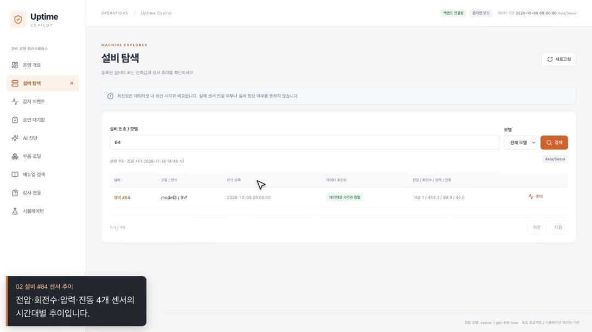

# Uptime Copilot

[한국어](README_KOR.md)

Uptime Copilot helps a maintenance operator move from a sensor alert to a reviewed work order. The React console brings together telemetry from 100 simulated machines, component failure-risk scores, maintenance history and evidence from the maintenance manual. A human reviews the proposed action before an approved urgent order can be sent to Atlas CMMS.

## Recorded walkthrough

[](https://surplus96.github.io/uptime-demo.html)

[Watch the full demo · 4 min 44 sec · Korean](https://surplus96.github.io/uptime-demo.html)

## Run locally

1. Install Docker with Compose. Download the five CSVs from the [Azure Predictive Maintenance dataset](https://www.kaggle.com/datasets/arnabbiswas1/microsoft-azure-predictive-maintenance) into `archive/` at the repository root. The backend expects `PdM_machines.csv`, `PdM_telemetry.csv`, `PdM_errors.csv`, `PdM_maint.csv` and `PdM_failures.csv` directly in that directory.
2. Run `cp backend/.env.example backend/.env`. Set `OPENAI_API_KEY` and an `OPENAI_MODEL` available to your account. Compose selects the OpenAI provider.
3. From the repository root, start the services and build the risk models once per data volume.

```sh
docker compose up -d --build
docker compose exec backend python -m ml.build_features
docker compose exec backend python -m ml.train
```

Open the [operations console](http://localhost:3001) or the [interactive API reference](http://localhost:8000/docs). The first startup downloads the embedding model and initializes SQLite. Follow startup with `docker compose logs -f backend`. Without trained models, diagnosis uses the sensor anomaly fallback and the inventory-risk endpoint returns HTTP 503. Stop with `docker compose down` to retain models and application state.

## Follow a maintenance case

1. Select a machine and inspect voltage, rotation, pressure and vibration over time. The console shows the observation time and the number of readings behind each average.
2. With the simulator stopped, inject degradation into one sensor and start the selected machine. Simulation stops after recording failure and maintenance. Open the detected event to inspect its evidence.
3. Request a diagnosis. Review the component, manual procedure, priority and parts availability. A saved thread lets the operator return to a pending decision.
4. Approve or reject the order. With the Atlas integration configured, an approved urgent order creates an external work order and registers its tasks. The console reports delivery separately from approval.

## Developer documentation

| Topic | Reference |
| --- | --- |
| Runtime data, storage, configuration and checks | [Developer guide](docs/DEVELOPMENT.md) |
| Frontend development and API behavior | [React guide](frontend/web/README.md) · [UI contract](docs/design/UI_API_CONTRACT.md) |
| Data inputs and model evaluation | [Dataset contract](docs/INTEGRATION_CONTRACT.md) · [Model card](docs/model_card.md) |
| Inventory and external work orders | [Parts assumptions](docs/design/parts_assumptions.md) · [Atlas CMMS delivery](docs/CMMS_DELIVERY.md) |

The Azure dataset is simulated. Inventory quantities, lead times and part identifiers are synthetic. Model evaluation describes performance on that dataset. Project code is available under the [MIT License](LICENSE).
