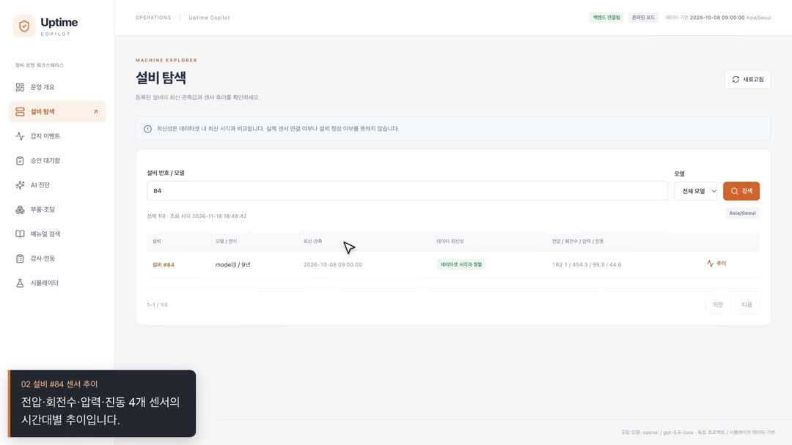

# Uptime Copilot

[English](README.md)

제조 설비의 이상 징후를 확인하고 정비 작업지시서를 검토하는 예지보전 애플리케이션입니다. React 운영 화면에서 시뮬레이션 설비 100대의 센서 추이, 부품별 고장 위험 점수, 정비 이력과 매뉴얼 근거를 함께 조회합니다. 운영자가 긴급 작업지시서를 승인하면 설정된 Atlas CMMS로 전송합니다.

## 시연 영상

[](https://surplus96.github.io/uptime-demo.html)

[전체 시연 보기 · 4분 44초](https://surplus96.github.io/uptime-demo.html)

## 로컬 실행

1. Docker와 Compose를 준비하고 [Azure Predictive Maintenance 데이터셋](https://www.kaggle.com/datasets/arnabbiswas1/microsoft-azure-predictive-maintenance)을 내려받습니다. 저장소 루트의 `archive/` 바로 아래에 `PdM_machines.csv`, `PdM_telemetry.csv`, `PdM_errors.csv`, `PdM_maint.csv`, `PdM_failures.csv`를 둡니다.
2. `cp backend/.env.example backend/.env`를 실행합니다. `OPENAI_API_KEY`와 해당 계정에서 사용할 수 있는 `OPENAI_MODEL`을 지정합니다. 기본 Compose 구성은 OpenAI를 사용합니다.
3. 저장소 루트에서 서비스를 기동합니다. 데이터 볼륨을 처음 사용할 때 다음 명령으로 피처를 생성하고 부품별 모델을 학습합니다.

```sh
docker compose up -d --build
docker compose exec backend python -m ml.build_features
docker compose exec backend python -m ml.train
```

[운영 화면](http://localhost:3001)과 [API 명세](http://localhost:8000/docs)에서 기동 결과를 확인합니다. 최초 기동 시 임베딩 모델을 내려받고 SQLite를 초기화합니다. 진행 상황은 `docker compose logs -f backend`로 확인합니다. 학습 모델이 없으면 진단은 센서 이상치 판정을 사용하고 재고 위험 API는 HTTP 503을 반환합니다. 종료할 때 `docker compose down`을 사용하면 데이터 볼륨이 유지됩니다.

## 시연 따라 하기

1. 설비 탐색에서 설비를 선택합니다. 전압·회전·압력·진동의 관측 시각과 구간별 평균, 최소·최대, 표본 수를 확인합니다.
2. 시뮬레이터가 정지된 상태에서 센서 하나에 열화를 주입하고 선택 설비를 시작합니다. 고장과 자동 정비 이력이 생기면 실행이 멈춥니다. 감지 이벤트에서 해당 설비의 판정 근거를 엽니다.
3. AI 진단을 요청하고 작업지시서의 정비 절차, 매뉴얼 출처, 우선순위와 부품 재고를 검토합니다. 화면을 닫아도 승인 대기함에서 다시 열 수 있습니다.
4. 작업지시서를 승인하거나 반려합니다. Atlas 연동을 구성한 경우 승인된 긴급 건은 외부 작업지시서와 점검 항목으로 등록됩니다. 승인 결과와 외부 전송 결과는 각각 확인할 수 있습니다.

## 개발 문서

| 주제 | 문서 |
| --- | --- |
| 런타임 데이터, 저장소, 환경 설정과 검사 | [개발 가이드](docs/DEVELOPMENT.md) |
| 프런트엔드 개발과 API 동작 | [React 개발 가이드](frontend/web/README.md) · [UI 계약](docs/design/UI_API_CONTRACT.md) |
| 입력 데이터와 모델 평가 | [데이터 계약](docs/INTEGRATION_CONTRACT.md) · [모델 카드](docs/model_card.md) |
| 재고와 외부 작업지시서 | [부품 데이터 기준](docs/design/parts_assumptions.md) · [Atlas CMMS 전송](docs/CMMS_DELIVERY.md) |

Azure 설비 이력은 시뮬레이션 데이터이며, 재고·리드타임·품번은 프로젝트에서 생성한 합성값입니다. 모델 평가 결과는 이 데이터셋에서 측정한 값입니다. 소스코드에는 [MIT 라이선스](LICENSE)가 적용됩니다.
